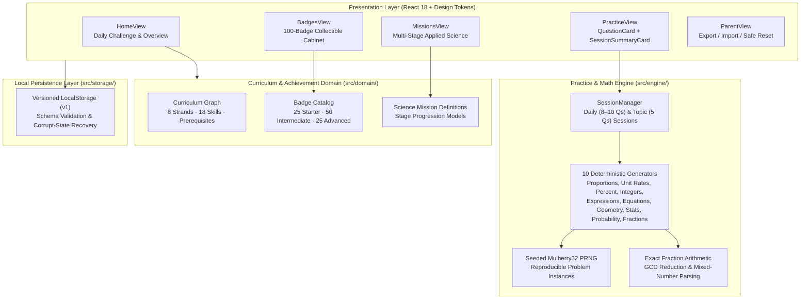

# NovaMath Lab


**NovaMath Lab** is a local-first, offline-capable mathematics and applied science practice platform designed for advanced middle-school learners (grades 6–7). It pairs a deterministic, seeded problem-generation engine and exact rational arithmetic with interactive science missions and a 100-badge progression system—without ads, cloud accounts, or external telemetry.

---

## 🎯 Use Case & Problem Statement

Many K–12 practice platforms optimize for speed drills, require cloud accounts that collect student telemetry, or rely on static question banks that learners quickly memorize. **NovaMath Lab** solves this by:

- **Deterministic, Infinite Practice:** Uses a seeded `Mulberry32` pseudo-random number generator (PRNG) and an exact `Fraction` arithmetic engine to generate reproducible, invariant-tested math problems across 8 curriculum strands and 18 skills.
- **Reasoning Over Speed:** Provides progressive one-step hints before submission and full worked explanations afterward, rewarding conceptual mastery and persistence.
- **Applied Science Missions:** Connects abstract math (ratios, linear equations, unit rates, geometry, statistics) to multi-stage real-world science scenarios.
- **Zero-Telemetry Parent Control:** Persists all progress locally in versioned browser storage (`localStorage` schema `v1`) with corrupt-data recovery and one-click JSON export, import, and safe reset.

---

## 🏗️ System Architecture



### Key Architectural Highlights
- **Exact Rational Math (`src/engine/fraction.ts`):** Avoids IEEE-754 floating-point drift by computing answers using reduced numerators/denominators and validating equivalent fractions, mixed numbers, units, and currency inputs.
- **Property-Based Invariant Verification (`tests/generatorInvariants.test.ts`):** Every problem generator is verified across 1,000 randomized seeds (10,000+ assertions) to guarantee valid prompts, non-degenerate parameters, hints, worked steps, and self-consistent answer evaluators.
- **Science-Journal Design System (`src/styles/`):** Custom CSS design tokens crafted for calm readability and touch-friendly tablet/desktop ergonomics.

---

## 📁 Project Structure

```text
novamath-lab/
├── .github/workflows/ci.yml      # GitHub Actions CI (typecheck, test suite, production build)
├── assets/badges/                # 4 master sprite sheets + 100 transparent badge icons + manifest
├── docs/
│   ├── BADGES.md                 # Complete 100-badge catalog specification
│   └── BADGE_ART_DIRECTION.md    # Visual style guide for badge assets
├── scripts/
│   └── split_badge_sheets.py     # Utility for slicing master badge sheets into individual icons
├── src/
│   ├── app/                      # Application shell & view routing
│   ├── components/               # Header, Navigation, QuestionCard, SessionSummaryCard
│   ├── domain/                   # Curriculum skill graph, mission definitions, badge catalog
│   ├── engine/                   # Mulberry32 PRNG, exact Fraction math, SessionManager, 10 generators
│   ├── features/                 # Feature views: home, practice, missions, badges, parent
│   ├── storage/                  # Versioned local persistence & JSON import/export
│   └── styles/                   # CSS custom properties (design tokens) & global stylesheet
├── tests/                        # 7 Vitest suites (75 tests including 10,000-iteration invariant checks)
├── PROJECT_PLAN.md               # Product scope, milestones, and acceptance criteria
└── package.json
```

---

## 🚀 Prerequisites & Setup

### Prerequisites
- **Node.js:** `v20+` (LTS recommended)
- **npm:** `v10+`

### Installation

```bash
# 1. Clone the repository
git clone https://github.com/gmanojkumar2000/novamath-lab.git
cd novamath-lab

# 2. Install locked dependencies
npm ci
```

---

## 💻 How to Run & Verify

### Start Local Development Server
```bash
npm run dev
```
Open `http://localhost:5173` in your browser.

### Run Automated Tests & Invariant Suite
```bash
# Run all 75 unit & property-based invariant tests
npm test

# Run tests in interactive watch mode
npm run test:watch
```

### Type Check & Production Build
```bash
# Verify strict TypeScript types
npm run typecheck

# Build static production bundle into dist/
npm run build

# Preview production build locally
npm run preview
```
